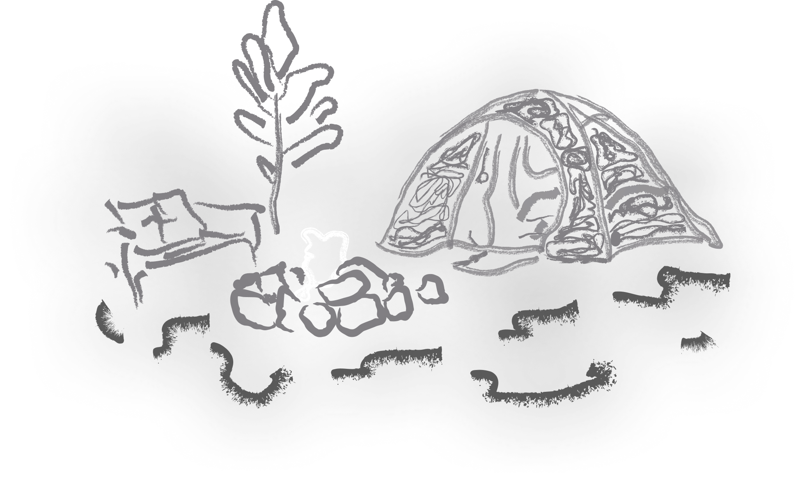

<!-- ===================== BANNER ===================== --> 
  
 <!-- ===================== LIVE STATS ===================== --> 
  &nbsp;&nbsp;&nbsp;&nbsp;&nbsp;&nbsp;  &nbsp;&nbsp;&nbsp;&nbsp;&nbsp;&nbsp;  
   <!-- ===================== ABOUT ME ===================== --> <table align="center" border="0" cellspacing="0" cellpadding="0"> <tr> <td width="45%" align="center" valign="middle">  </td> <td width="55%" align="center" valign="middle"> <h3 align="center">About me</h3> 
 I'm Mohit, a designer and aspiring digital product builder interested in creating clean, intuitive, and user-friendly digital experiences. My work focuses on UI/UX design, building real webapps, and exploring the connection between design and technology. I enjoy experimenting with new ideas, building projects, and continuously improving my skills. 
 </td> </tr> </table>   <!-- ===================== WHAT I'M WORKING ON ===================== --> <h3 align="center">What I'm Working On</h3> 
 I'm currently exploring interface design, responsive websites, and offline-first applications. Through personal projects, I'm learning how to turn design concepts into functional digital experiences while developing a stronger understanding of the entire process, from initial ideas to implementation. 
 <!-- ===================== SKILLS / STACK ===================== --> <!-- Row 1: three stacks --> 
 <!-- Stack 1: Design tools -->   &nbsp;&nbsp; <!-- Stack 2: Web stack -->      &nbsp;&nbsp; <!-- Stack 3: Builders -->   
 <!-- Row 2: fourth stack --> 
     
   <!-- ===================== OUTSIDE WORK + SOCIAL LINKS ===================== --> <table align="center" border="0" cellspacing="0" cellpadding="0"> <tr> <td width="50%" align="center" valign="middle"> 
 Outside of designing and building, I enjoy drawing, listening to music, and experimenting with new ideas. My long-term goal is to create useful digital products, develop my skills, and eventually build my own startup. 
 </td> <td width="50%" align="center" valign="middle"> <!-- Row 1 -->  &nbsp;&nbsp;&nbsp;&nbsp;&nbsp;&nbsp;&nbsp;&nbsp;    <!-- Row 2: LinkedIn + Fiverr -->  &nbsp;&nbsp;&nbsp;&nbsp;&nbsp;  &nbsp;&nbsp;&nbsp;&nbsp;&nbsp; <!-- Row 2: Instagram -->    <!-- Row 3 -->  &nbsp;&nbsp;&nbsp;&nbsp;&nbsp;&nbsp;&nbsp;&nbsp;&nbsp;&nbsp;&nbsp;&nbsp;  </td> </tr> </table>
